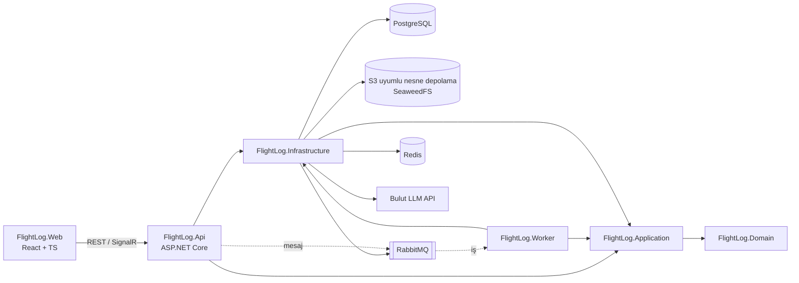
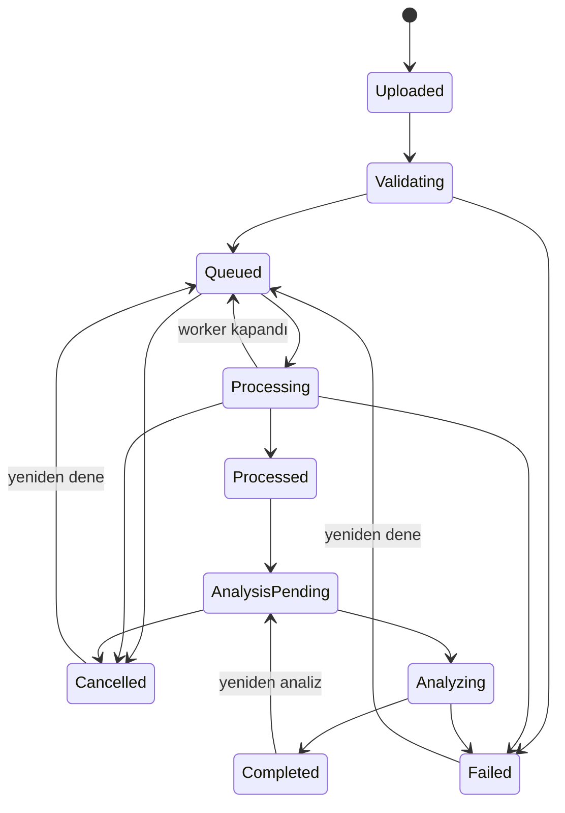

# Mimari

Bu doküman Aşama 0 değerlendirmesini, önerilen mimariyi, veri modelini ve API kaynaklarını içerir. Kararların gerekçeleri [docs/adr](adr/) altındadır.

## 1. Repository'nin başlangıç durumu

- Proje sıfırdan başlatıldı; mevcut kod yoktu. Kullanıcının GitHub hesabında bu ürüne ait bir repository bulunmadığı doğrulandı (`uav-ground-control-station` farklı bir ürün olduğu için kullanılmadı).
- Geliştirme ortamı: Ubuntu 24.04, .NET SDK 10.0.112 (Ubuntu arşivinden), Docker 29, Node 22, Python 3.12.
- Doğrulanan dış kaynaklar: nuget.org paketleri, Docker Hub imajları, pypi (pyulog 1.2.4 BSD-3, pymavlink 2.4.50 LGPL-3), PX4 pyulog örnek dosyaları (raw.githubusercontent.com).

## 2. Genel yapı

İlk sürüm **modüler monolit + ayrı worker** olarak tasarlanmıştır ([ADR-0001](adr/0001-modular-monolith.md)).



Bağımlılık yönü: `Api/Worker → Infrastructure → Application → Domain`. Domain hiçbir altyapı paketine bağımlı değildir; bu kural mimari testlerle (`FlightLog.UnitTests/Architecture`) doğrulanır.

### Katmanlar

| Proje | Sorumluluk | Bağımlılıklar |
|---|---|---|
| `FlightLog.Domain` | Entity'ler, değer nesneleri, durum makineleri, iş kuralları, domain hataları | Yok |
| `FlightLog.Application` | Use case servisleri, DTO'lar, doğrulayıcılar, yetki kontrolleri, altyapı arayüzleri (`IApplicationDbContext`, `ICurrentUser`, `IFileStorage`, `IFlightLogParser`, `IFlightAnalysisProvider`) | Domain, EF Core abstractions, FluentValidation |
| `FlightLog.Infrastructure` | EF Core `DbContext`, migration'lar, Identity, nesne depolama, RabbitMQ, Redis, parser adaptörleri, LLM adaptörü | Application |
| `FlightLog.Contracts` | Kuyruk mesajları ve worker/API arasında paylaşılan sözleşmeler (sürümlü) | Yok |
| `FlightLog.Api` | HTTP endpoint'leri, kimlik doğrulama, Problem Details, OpenAPI, sağlık kontrolleri | Application, Infrastructure |
| `FlightLog.Worker` | Log işleme, normalizasyon, kural analizi, AI analizi (Aşama 3+) | Application, Infrastructure, Contracts |
| `FlightLog.Web` | React + TypeScript arayüzü (Aşama 5) | API |

Application katmanı EF Core `DbSet`'lerine `IApplicationDbContext` üzerinden erişir; genel amaçlı repository/unit-of-work katmanı eklenmez ([ADR-0002](adr/0002-dotnet-postgres-efcore.md)). Kuyruk, depolama ve LLM gibi gerçekten değiştirilebilir dış bağımlılıklar arayüz arkasındadır.

## 3. Klasör yapısı

```
flightlog-intelligence/
├── src/
│   ├── FlightLog.Domain/
│   ├── FlightLog.Application/
│   ├── FlightLog.Infrastructure/
│   ├── FlightLog.Contracts/        (Aşama 2-4)
│   ├── FlightLog.Api/
│   ├── FlightLog.Worker/           (Aşama 3-4)
│   └── FlightLog.Web/              (Aşama 5)
├── tests/
│   ├── FlightLog.UnitTests/
│   ├── FlightLog.IntegrationTests/
│   └── FlightLog.ParserTests/      (Aşama 3)
├── docs/
│   ├── architecture.md, requirements.md, roadmap.md
│   └── adr/
├── docker-compose.yml
├── .env.example
└── .github/workflows/ci.yml
```

Henüz işlevi olmayan projeler boş iskelet olarak eklenmez; ilgili aşamada oluşturulur.

## 4. Veri modeli

### 4.1 Depolama ayrımı

| Veri | Yer | Neden |
|---|---|---|
| Kullanıcı, ekip, proje, araç, uçuş, dosya metadata'sı, iş durumu, bulgu, yorum, denetim | PostgreSQL | İlişkisel, sorgulanan, işlemsel veri |
| Ham log dosyası | Nesne depolama (`raw/{sha256}`) | Büyük, değişmez ikili veri |
| Sinyal örnekleri (ham alanlar ve normalize sinyaller) | Nesne depolama, seri (mesaj + instance) başına sıkıştırılmış blok dosyaları: `derived/{flightId}/{jobId}/{seri}/{blok}.fls` | Milyonlarca örnek; zaman aralığı ile okunur, satır bazlı sorgulanmaz |
| Sinyal kataloğu, blok indeksi, özet istatistikler | PostgreSQL | Hangi sinyal var, hangi zaman aralığı hangi blokta, min/max/ortalama |
| Olaylar, mod geçişleri, parametreler, işleme denemeleri | PostgreSQL | Sayıları küçük (yüzler-binler), filtrelenir ve birleştirilir |

Gerekçe ve alternatifler (tek büyük tablo, TimescaleDB, Parquet): [ADR-0005](adr/0005-time-series-storage.md). Nesne depolama sunucusu: [ADR-0009](adr/0009-object-storage-server.md).

Ham dosyalar içerik adreslidir: aynı içerik farklı ekiplerce yüklenirse tek nesne saklanır, ama her ekibin kendi `FlightLogFile` kaydı vardır. Nesne, ona başvuran son kayıt silindiğinde silinir.

### 4.2 ERD (hedef v1 şeması)

Aşama 1'de yalnızca kimlik, ekip, ekip üyeliği ve proje tabloları oluşturulur; diğerleri ilgili aşamada migration ile eklenir.

```mermaid
erDiagram
    USER ||--o{ TEAM_MEMBER : "üye"
    TEAM ||--o{ TEAM_MEMBER : ""
    TEAM ||--o{ PROJECT : ""
    TEAM ||--o{ AIRCRAFT : ""
    PROJECT ||--o{ FLIGHT : ""
    AIRCRAFT ||--o{ FLIGHT : ""
    FLIGHT ||--o{ FLIGHT_LOG_FILE : ""
    FLIGHT_LOG_FILE ||--o{ LOG_PROCESSING_JOB : ""
    FLIGHT ||--o{ FLIGHT_SIGNAL_SERIES : ""
    LOG_PROCESSING_JOB ||--o{ FLIGHT_SIGNAL_SERIES : ""
    FLIGHT_SIGNAL_SERIES ||--o{ SIGNAL_CHUNK : ""
    FLIGHT_SIGNAL_SERIES ||--o{ FLIGHT_SIGNAL : ""
    FLIGHT ||--o{ FLIGHT_EVENT : ""
    FLIGHT ||--o{ FLIGHT_PARAMETER : ""
    FLIGHT ||--o{ ANALYSIS_RUN : ""
    ANALYSIS_RUN ||--o{ ANALYSIS_FINDING : ""
    ANALYSIS_FINDING ||--o{ ANALYSIS_EVIDENCE : ""
    ANALYSIS_FINDING ||--o{ FINDING_ASSIGNMENT : ""
    FLIGHT ||--o{ COMMENT : ""
    FLIGHT }o--o{ TAG : ""
    TEAM ||--o{ AUDIT_LOG : ""
```



### 4.3 Veri sözlüğü (özet)

| Entity | Önemli alanlar | Kısıtlar / indeksler | Aşama |
|---|---|---|---|
| `User` (Identity) | Id (uuid), Email, DisplayName, CreatedAt | Email unique | 1 |
| `Team` | Id, Name, CreatedAt, CreatedBy | — | 1 |
| `TeamMember` | TeamId, UserId, Role (ProjectManager/Engineer/Viewer), JoinedAt | PK (TeamId, UserId); idx UserId | 1 |
| `Project` | Id, TeamId, Name, Description, CreatedAt, UpdatedAt, Version (xmin) | unique (TeamId, Name); idx TeamId | 1 |
| `Aircraft` | Id, TeamId, Name, Identifier, Type, Autopilot, FirmwareName/Version, FlightController, Hardware, Description, Tags | unique (TeamId, Identifier) | 2 |
| `Flight` | Id, ProjectId, AircraftId?, StartedAt?, DurationUs?, Autopilot, FirmwareVersion?, VehicleType?, Hardware?, BootTimeUtc?, LogStartTimestampUs?, LogMetadata (jsonb), OccurredAt | idx (ProjectId, OccurredAt), (AircraftId, OccurredAt) | 2-3 |
| `FlightLogFile` | Id, FlightId, TeamId, OriginalFileName, SizeBytes, Sha256, DetectedFormat, StorageKey, Status, UploadedBy, UploadedAt | unique (TeamId, Sha256); idx Status | 2 |
| `LogProcessingJob` | Id, LogFileId, FlightId, Attempt, Outcome (Running/Succeeded/Failed/Cancelled), WorkerId, CorrelationId, StoragePrefix, StartedAt, FinishedAt, DurationMs, AllocatedBytes, ParserName/Version, NormalizationVersion, kayıt/seri/sinyal/olay/parametre/blok sayıları, ChunkBytes, SkippedBytes, Truncated, Corrupt, Warnings (text[]), FailureCode, FailureMessage | idx (LogFileId, StartedAt) | 3 |
| `FlightSignalSeries` | Id, FlightId, JobId, Message, Instance, Kind (Raw/Normalized), RecordCount, FirstTimestampUs, LastTimestampUs, ColumnCount, StoragePrefix | idx FlightId | 3 |
| `SignalChunks` | SeriesId, Index, StartTimestampUs, EndTimestampUs, RecordCount, SizeBytes | PK (SeriesId, Index) | 3 |
| `FlightSignal` | Id, FlightId, SeriesId, Name, Kind, Message, Instance, Field, Column, SourceType, Unit, Multiplier, SourceMessage/Instance/Fields, Conversion, NormalizationVersion, SampleCount, InvalidCount, Min, Max, First/LastTimestampUs | unique (FlightId, Name) | 3 |
| `FlightEvent` | Id, FlightId, TimestampUs, Kind (Message/ModeChange/Armed/Disarmed/Failsafe/Error/Event/Dropout), Severity?, Source, Text, Data (jsonb) | idx (FlightId, TimestampUs) | 3 |
| `FlightParameter` | Id, FlightId, Name, Value, DefaultValue?, TimestampUs? (null = log başındaki değer) | idx (FlightId, Name) | 3 |
| `AnalysisRun` | Id, FlightId, Kind (Rules/AI), EngineVersion, Model?, PromptVersion?, InputSummary (jsonb), Cost?, LatencyMs?, Status | idx FlightId | 4/6 |
| `AnalysisFinding` | Id, RunId, RuleId, RuleVersion, Title, Description, StartUs, EndUs, Severity, Confidence, Measured (jsonb), Threshold (jsonb), Limitations, ReviewStatus, Version | idx (RunId), (FlightId, ReviewStatus) | 4 |
| `AnalysisEvidence` | FindingId, SignalId?/EventId?, StartUs, EndUs, Value (jsonb) | — | 4/6 |
| `Comment` | Id, FlightId, AuthorId, Body, StartUs?, EndUs?, CreatedAt, EditedAt | idx (FlightId, CreatedAt) | 7 |
| `FindingAssignment` | FindingId, AssigneeId, AssignedBy, AssignedAt | — | 7 |
| `Tag` / `FlightTag` | TeamId, Name / FlightId, TagId | unique (TeamId, Name) | 7 |
| `AuditLog` | Id, TeamId?, ActorId, Action, EntityType, EntityId, Changes (jsonb), OccurredAt | idx (TeamId, OccurredAt) | 7 |
| `AiProviderConfiguration` | Provider, Model, Enabled, MaxTokens, Limits (anahtar burada değil) | — | 6 |
| `FlightComparison`, `Report` | Hesaplanmış çıktı metadata'sı; içerik nesne depolamada | — | 7 |

Tüm zaman damgaları UTC `timestamptz`. Uçuş içi zamanlar `bigint` mikro saniye (orijinal boot zamanı) olarak saklanır.

## 5. Zaman modeli

| Format | Orijinal zaman | Mutlak zaman |
|---|---|---|
| PX4 ULog | Her mesajda `uint64 timestamp`: açılıştan itibaren µs (monoton saat). SITL logları bu saati Unix epoch'tan sayabilir. Hiç yayınlanmamış topic'ler `timestamp = 0` taşır. | GPS konumu (`vehicle_gps_position`, yoksa `sensor_gps`) `fix_type ≥ 3` ve `time_utc_usec > 0` olduğunda: açılış UTC'si = `time_utc_usec − timestamp`. |
| ArduPilot DataFlash | `TimeUS`, yoksa `TimeMS × 1000`, ikisi de yoksa bir önceki mesajın zamanı (pymavlink ile aynı). | `GPS` instance 0, `Status ≥ 3` ve `GWk > 0`: GPS zamanı = 1980-01-06 + `GWk` hafta + `GMS` ms; UTC = GPS zamanı − artık saniye (2017'den beri 18 s, önceki tarihler için IERS tablosu); açılış UTC'si = UTC − `TimeUS`. |

- **Orijinal zaman hiç değiştirilmez.** Sinyal blokları, olaylar ve parametre değişiklikleri logun kendi saatindeki µs değerini saklar; API de bu değeri döner (`timestampsUs`, `timestampUs`).
- **Uçuş başlangıcı**: ULog'da dosya başlığındaki zaman damgası (logger'ın başladığı an; pyulog `start_timestamp` ile aynı), DataFlash'ta ilk veri kaydının zamanı. `Flight.LogStartTimestampUs` olarak saklanır; süre = son zaman damgası − başlangıç.
- **UTC**: `Flight.BootTimeUtc` biliniyorsa `utc = BootTimeUtc + t µs` ve `StartedAt = BootTimeUtc + LogStartTimestampUs`. GPS zamanı yoksa ikisi de `null` kalır; tahmin yapılmaz. Listeleme tarihi (`OccurredAt`) o durumda yükleme zamanıdır.
- Açılış zamanları gerçek fixture'larda pyulog/pymavlink ile hesaplanan değerlerle birebir doğrulandı (`InterpreterTests`).

### 5.1 Sinyaller ve normalizasyon (v1)

Her sayısal log alanı bir **ham sinyal** olarak saklanır: ad `Mesaj.Alan`, instance 0 dışında `Mesaj#n.Alan` (`ATT.Roll`, `IMU#1.AccX`, `vehicle_attitude.q[0]`). Birim logun beyan ettiğidir (DataFlash `UNIT`/`FMTU`; ULog birim taşımaz). DataFlash'in beyan ettiği ama değere uygulanmamış çarpan (`MULT`) `Multiplier` olarak saklanır ve API okurken uygular (ör. `GPS.GMS`: ms → s). Metin alanları sinyal olmaz; mesajlar olay olarak saklanır.

**Normalize sinyaller** (`attitude.*`, `gps.*`, `battery.*`) biçimden bağımsız adlardır ve kaynaklarını saklar (`SourceMessage`, `SourceFields`, `Conversion`, `NormalizationVersion = 1`). Kurallar `src/FlightLog.LogParsing/Normalization/SignalNormalizer.cs` içindedir:

| Sinyal | Birim | PX4 | ArduPilot |
|---|---|---|---|
| `attitude.roll`, `.pitch`, `.yaw` | deg | `vehicle_attitude.q[0..3]` → Euler ZYX, rad → deg; yaw −180…180 | `ATT.Roll/Pitch/Yaw`; yaw 0…360 → −180…180 |
| `gps.lat`, `.lon` | deg | `latitude_deg/longitude_deg` (1.14+) veya `lat/lon` × 1e-7 | `GPS.Lat/Lng` |
| `gps.alt_msl` | m | `altitude_msl_m` veya `alt` × 1e-3 | `GPS.Alt` |
| `gps.fix_type`, `.satellites`, `.hdop`, `.ground_speed` | —, —, —, m/s | `fix_type`, `satellites_used`, `hdop`, `vel_m_s` | `Status`, `NSats`, `HDop`, `Spd` |
| `battery.voltage`, `.current`, `.remaining` | V, A, % | `battery_status.voltage_v`, `current_a` (−1 → geçersiz), `remaining` × 100 (negatif → geçersiz) | `BAT.Volt`, `Curr`, `RemPct` (255 → geçersiz) |

Kurallar yalnızca instance 0 kaynağını kullanır. Kaynak alanlardan biri yoksa sinyal hiç üretilmez (sıfır yazılmaz). Geçersiz/ölçülmemiş değerler `NaN` olarak saklanır, API'de `null` döner ve katalogda `InvalidCount` ile sayılır. Titreşim ve barometrik irtifa v1'de normalize edilmedi: PX4 ve ArduPilot'ta anlamları farklı (tek titreşim metriği / eksen başına; AMSL / açılışa göre), ham sinyal olarak kullanılabilirler.

## 6. Parser doğrulama planı

Ayrıntı: [ADR-0004](adr/0004-native-csharp-parsers.md).

1. **Resmi spesifikasyon**: PX4 ULog File Format (docs.px4.io) ve ArduPilot DataFlash FMT/FMTU tanımları.
2. **Native C# parser**: `FlightLog.LogParsing` projesi (yalnızca .NET temel kütüphanesi), arabellekli seekable okuyucu ile format başına bir `IFlightLogParser` (`ULogParser`, `DataFlashParser`); kayıtlar bir `ILogRecordSink`'e akıtılır, dosya belleğe alınmaz.
3. **Oracle testleri**: Aynı fixture dosyaları pyulog (BSD-3) ve pymavlink (LGPL-3) ile okunup beklenen değerler JSON olarak üretilir; C# parser çıktısı bu JSON'larla karşılaştırılır. Python yalnızca test verisi üretiminde kullanılır, çalışma zamanında kullanılmaz.
4. **Fixture'lar**: pyulog repository'sindeki örnek `.ulg` dosyaları (BSD-3), ArduPilot SITL'den üretilen veya lisansı uygun `.bin` dosyaları; ayrıca bozuk/kesik/bilinmeyen mesaj içeren küçük üretilmiş dosyalar.
5. **Sınırlar**: parser zaman aşımı, maksimum mesaj boyutu, maksimum format sayısı; aşıldığında kontrollü hata.

## 7. API kaynakları

Sürümleme: URL segmenti (`/api/v1/...`). Kırıcı değişiklikte `v2` eklenir; v1 belgelenmiş bir süre korunur.

| Kaynak | Endpoint'ler | Aşama |
|---|---|---|
| Auth | `POST /api/v1/auth/register`, `POST /api/v1/auth/login`, `POST /api/v1/auth/refresh`, `GET /api/v1/auth/me` | 1 |
| Admin users | `GET/POST /api/v1/admin/users`, `POST /api/v1/admin/users/{id}/disable`, `POST /api/v1/admin/users/{id}/enable` (yalnızca Administrator) | 2 |
| Teams | `GET/POST /api/v1/teams`, `GET /api/v1/teams/{id}` | 1 |
| Team members | `GET/POST /api/v1/teams/{id}/members`, `PUT/DELETE /api/v1/teams/{id}/members/{userId}` | 1 |
| Projects | `GET/POST /api/v1/teams/{teamId}/projects`, `GET/PUT/DELETE /api/v1/projects/{id}` | 1 |
| Aircraft | `GET/POST /api/v1/teams/{teamId}/aircraft`, `GET/PUT/DELETE /api/v1/aircraft/{id}` | 2 |
| Flights | `GET /api/v1/flights?teamId&projectId&aircraftId&autopilot&status&firmware&from&to&search&sort&page&pageSize`, `GET/PUT/DELETE /api/v1/flights/{id}` | 2 |
| Uploads | `POST /api/v1/projects/{id}/logs?aircraftId&name` (multipart, alan `file`; yeni uçuş oluşturur), `GET /api/v1/log-files/{id}`, `GET /api/v1/log-files/{id}/content` | 2 |
| Processing state | `POST /api/v1/log-files/{id}/cancel`, `POST /api/v1/log-files/{id}/retry` | 2 |
| Processing jobs | `GET /api/v1/log-files/{id}/jobs` (deneme geçmişi, süre, bellek, parser istatistikleri) | 3 |
| Signals | `GET /api/v1/flights/{id}/signals?kind&search`, `GET /api/v1/flights/{id}/signals/data?names&fromUs&toUs&maxPoints` | 3 |
| Events | `GET /api/v1/flights/{id}/events?kind&maxSeverity&fromUs&toUs&search&page&pageSize` | 3 |
| Parameters | `GET /api/v1/flights/{id}/parameters?search&changedOnly` | 3 |
| Analysis | `POST /api/v1/flights/{id}/analysis-runs`, `GET /api/v1/analysis-runs/{id}`, `GET /api/v1/analysis-runs/{id}/findings` | 4/6 |
| Findings | `PATCH /api/v1/findings/{id}` (durum), `POST /api/v1/findings/{id}/assignments` | 7 |
| Comparisons | `POST /api/v1/flights/compare` | 7 |
| Comments, Tags | `GET/POST /api/v1/flights/{id}/comments`, `PUT /api/v1/flights/{id}/tags` | 7 |
| Reports | `GET /api/v1/flights/{id}/report?format=json|csv` | 7 |

Kurallar: DTO ile entity ayrımı, FluentValidation, Problem Details (RFC 9457), `CancellationToken`, sayfalama (`page`, `pageSize` ≤ 100), başka ekibin kaynağı için 404.

## 8. Asenkron işleme

Ayrıntı: [ADR-0006](adr/0006-messaging-and-background-jobs.md).

- İş durumu PostgreSQL'de tutulur (gerçeğin kaynağı); RabbitMQ yalnızca "şu iş hazır" sinyalini taşır.
- Mesaj yayını transactional outbox ile yapılır: dosya kaydı ve outbox satırı aynı transaction'da yazılır.
- Worker işi alırken `UPDATE ... WHERE status = 'Queued'` ile iyimser kilit alır; aynı mesaj iki kez gelirse ikinci işlem hiçbir şey yapmaz (idempotent).
- Türetilmiş veri yazımı "uçuşa ait önceki çıktıları sil + yenilerini yaz" tek transaction'da yapılır; tekrar işlemede yinelenme olmaz.
- Retry: sınırlı deneme ve artan bekleme; tükenince dead-letter queue + `Failed` durumu.
- Hangfire yalnızca zamanlanmış bakım işleri için (yarım kalan işlerin kurtarılması, saklama temizliği); işleme kuyruğu değildir.

**Aşama 3 uygulaması (RabbitMQ öncesi):** `FlightLog.Worker` servisi veritabanını yoklar (`Processing:PollInterval`, varsayılan 2 s):

1. En eski `Queued` dosyayı `Processing` yapar ve bir `LogProcessingJob` açar. Dosyanın satır sürümü (`xmin`) sayesinde bu bir compare-and-set'tir; birden çok worker aynı dosyayı alamaz.
2. Ham dosyayı geçici dizine indirir, parser + yorumlayıcı + normalizasyon + blok yazıcı tek geçişte çalışır (`Processing:ParserTimeout`, varsayılan 15 dk).
3. Bloklar `derived/{flightId}/{jobId}/…` altına yüklenir; ardından tek transaction'da uçuşun eski sinyal/olay/parametre satırları silinir, yenileri yazılır, uçuş bilgileri güncellenir, dosya `Processed` olur. Commit sonrası önceki işlerin blokları silinir.
4. Hata: parser'ın kararlı kodu (`ulog.invalid_header`, `processing.no_data`, `parser.timeout`…) dosyaya ve işe yazılır; beklenmeyen hatada kullanıcıya yalnızca `processing.failed` ve korelasyon kimliği gösterilir, ayrıntı loglanır.
5. Kullanıcı işlem sırasında iptal ederse (her 5 s'de kontrol) iş `Cancelled` biter, yazılan bloklar silinir. Worker düzgün kapanırken dosya `Queued` durumuna döner. 30 dakikadan uzun `Processing` kalan dosyalar (çöken worker) `processing.interrupted` koduyla `Failed` yapılır.

API geliştirme ortamında aynı döngüyü kendi içinde çalıştırabilir (`Processing:Enabled = true`, `appsettings.Development.json`); Docker Compose'da işleme yalnızca `worker` servisindedir.

### İşleme durum makinesi



Geçiş tablosu `ProcessingStatusTransitions` içindedir (`src/FlightLog.Domain/Flights/ProcessingStatus.cs`); tüm durum çiftleri unit testle doğrulanır. `Failed` yalnızca hata kodu ve mesajıyla (`Fail`) girilebilir. Aşama 2'de yükleme `Uploaded → Validating → Queued` adımlarını aynı istekte tamamlar; `Queued → Processing → Processed` Aşama 3'te worker tarafından yürütülür; analiz durumları Aşama 4'te kullanılacak.

## 9. Güvenlik özeti

- ASP.NET Core Identity, bearer token + refresh token; parola politikası; giriş endpoint'lerinde rate limiting ve hesap kilitleme.
- Yetkilendirme backend'de, Application katmanında kaynak bazlı: her sorgu kullanıcının ekip üyeliğine göre filtrelenir.
- Ham log güvenilmeyen girdi: içerik doğrulama, boyut sınırı, parser zaman/bellek sınırı, depolama anahtarı sunucuda üretilir.
- Gizli bilgiler environment variable / secret store; `.env` dosyası git dışında.
- LLM'e giden veri minimize edilir; log içindeki metinler talimat olarak yorumlanmaz.

## 10. Gözlemlenebilirlik

- Serilog: JSON çıktısı, istek logları, korelasyon kimliği (`X-Correlation-Id`).
- OpenTelemetry (Aşama 8): ASP.NET Core, HttpClient, EF Core, RabbitMQ izleri; parser süresi, bellek, kuyruk bekleme süresi metrikleri.
- Sağlık: `/health/live` (süreç) ve `/health/ready` (PostgreSQL ve nesne depolama; sonraki aşamalarda RabbitMQ, Redis).
