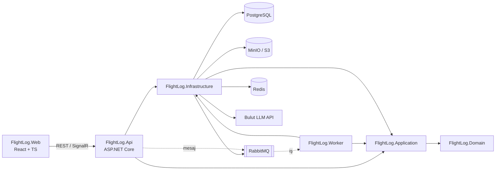
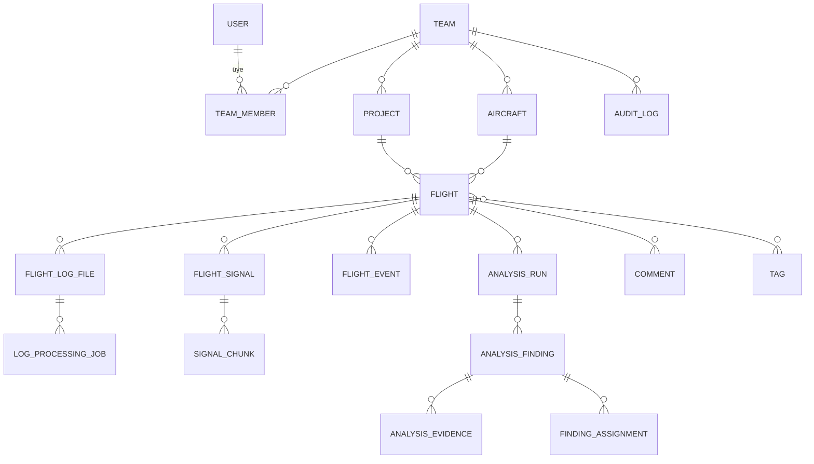
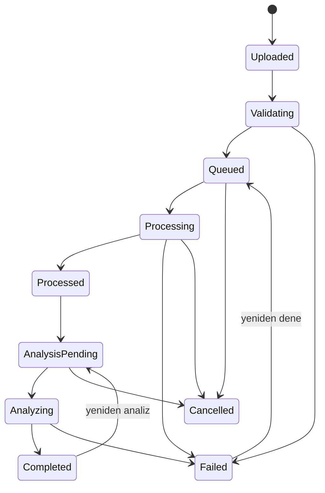

# Mimari

Bu doküman Aşama 0 değerlendirmesini, önerilen mimariyi, veri modelini ve API kaynaklarını içerir. Kararların gerekçeleri [docs/adr](adr/) altındadır.

## 1. Repository'nin başlangıç durumu

- Proje sıfırdan başlatıldı; mevcut kod yoktu. Kullanıcının GitHub hesabında bu ürüne ait bir repository bulunmadığı doğrulandı (`uav-ground-control-station` farklı bir ürün olduğu için kullanılmadı).
- Geliştirme ortamı: Ubuntu 24.04, .NET SDK 10.0.112 (Ubuntu arşivinden), Docker 29, Node 22, Python 3.12.
- Doğrulanan dış kaynaklar: nuget.org paketleri, Docker Hub imajları, pypi (pyulog 1.2.4 BSD-3, pymavlink 2.4.50 LGPL-3), PX4 pyulog örnek dosyaları (raw.githubusercontent.com).

## 2. Genel yapı

İlk sürüm **modüler monolit + ayrı worker** olarak tasarlanmıştır ([ADR-0001](adr/0001-modular-monolith.md)).



Bağımlılık yönü: `Api/Worker → Infrastructure → Application → Domain`. Domain hiçbir altyapı paketine bağımlı değildir; bu kural mimari testlerle (`FlightLog.UnitTests/Architecture`) doğrulanır.

### Katmanlar

| Proje | Sorumluluk | Bağımlılıklar |
|---|---|---|
| `FlightLog.Domain` | Entity'ler, değer nesneleri, durum makineleri, iş kuralları, domain hataları | Yok |
| `FlightLog.Application` | Use case servisleri, DTO'lar, doğrulayıcılar, yetki kontrolleri, altyapı arayüzleri (`IApplicationDbContext`, `ICurrentUser`, `IFileStorage`, `IFlightLogParser`, `IFlightAnalysisProvider`) | Domain, EF Core abstractions, FluentValidation |
| `FlightLog.Infrastructure` | EF Core `DbContext`, migration'lar, Identity, nesne depolama, RabbitMQ, Redis, parser adaptörleri, LLM adaptörü | Application |
| `FlightLog.Contracts` | Kuyruk mesajları ve worker/API arasında paylaşılan sözleşmeler (sürümlü) | Yok |
| `FlightLog.Api` | HTTP endpoint'leri, kimlik doğrulama, Problem Details, OpenAPI, sağlık kontrolleri | Application, Infrastructure |
| `FlightLog.Worker` | Log işleme, normalizasyon, kural analizi, AI analizi (Aşama 3+) | Application, Infrastructure, Contracts |
| `FlightLog.Web` | React + TypeScript arayüzü (Aşama 5) | API |

Application katmanı EF Core `DbSet`'lerine `IApplicationDbContext` üzerinden erişir; genel amaçlı repository/unit-of-work katmanı eklenmez ([ADR-0002](adr/0002-dotnet-postgres-efcore.md)). Kuyruk, depolama ve LLM gibi gerçekten değiştirilebilir dış bağımlılıklar arayüz arkasındadır.

## 3. Klasör yapısı

```
flightlog-intelligence/
├── src/
│   ├── FlightLog.Domain/
│   ├── FlightLog.Application/
│   ├── FlightLog.Infrastructure/
│   ├── FlightLog.Contracts/        (Aşama 2-4)
│   ├── FlightLog.Api/
│   ├── FlightLog.Worker/           (Aşama 3-4)
│   └── FlightLog.Web/              (Aşama 5)
├── tests/
│   ├── FlightLog.UnitTests/
│   ├── FlightLog.IntegrationTests/
│   └── FlightLog.ParserTests/      (Aşama 3)
├── docs/
│   ├── architecture.md, requirements.md, roadmap.md
│   └── adr/
├── docker-compose.yml
├── .env.example
└── .github/workflows/ci.yml
```

Henüz işlevi olmayan projeler boş iskelet olarak eklenmez; ilgili aşamada oluşturulur.

## 4. Veri modeli

### 4.1 Depolama ayrımı

| Veri | Yer | Neden |
|---|---|---|
| Kullanıcı, ekip, proje, araç, uçuş, dosya metadata'sı, iş durumu, bulgu, yorum, denetim | PostgreSQL | İlişkisel, sorgulanan, işlemsel veri |
| Ham log dosyası | Nesne depolama (`raw/{sha256}`) | Büyük, değişmez ikili veri |
| Normalize sinyal örnekleri | Nesne depolama, sinyal başına sıkıştırılmış blok dosyaları | Milyonlarca örnek; zaman aralığı ile okunur, satır bazlı sorgulanmaz |
| Sinyal kataloğu, blok indeksi, özet istatistikler | PostgreSQL | Hangi sinyal var, hangi zaman aralığı hangi blokta, min/max/ortalama |
| Olaylar, mod geçişleri, parametreler | PostgreSQL | Sayıları küçük (yüzler-binler), filtrelenir ve birleştirilir |

Gerekçe ve alternatifler (tek büyük tablo, TimescaleDB, Parquet): [ADR-0005](adr/0005-time-series-storage.md).

### 4.2 ERD (hedef v1 şeması)

Aşama 1'de yalnızca kimlik, ekip, ekip üyeliği ve proje tabloları oluşturulur; diğerleri ilgili aşamada migration ile eklenir.



### 4.3 Veri sözlüğü (özet)

| Entity | Önemli alanlar | Kısıtlar / indeksler | Aşama |
|---|---|---|---|
| `User` (Identity) | Id (uuid), Email, DisplayName, CreatedAt | Email unique | 1 |
| `Team` | Id, Name, CreatedAt, CreatedBy | — | 1 |
| `TeamMember` | TeamId, UserId, Role (ProjectManager/Engineer/Viewer), JoinedAt | PK (TeamId, UserId); idx UserId | 1 |
| `Project` | Id, TeamId, Name, Description, CreatedAt, UpdatedAt, Version (xmin) | unique (TeamId, Name); idx TeamId | 1 |
| `Aircraft` | Id, TeamId, Name, Identifier, Type, Autopilot, FirmwareName/Version, FlightController, Hardware, Description, Tags | unique (TeamId, Identifier) | 2 |
| `Flight` | Id, ProjectId, AircraftId?, StartedAtUtc?, DurationUs?, Autopilot, FirmwareVersion?, ProcessingStatus, AnalysisStatus, FindingCount, HealthScore? | idx (ProjectId, StartedAtUtc), (AircraftId, StartedAtUtc) | 2 |
| `FlightLogFile` | Id, FlightId, TeamId, OriginalFileName, SizeBytes, Sha256, DetectedFormat, StorageKey, Status, UploadedBy, UploadedAt | unique (TeamId, Sha256); idx Status | 2 |
| `LogProcessingJob` | Id, FileId, Attempt, Status, ParserName/Version, CorrelationId, StartedAt, FinishedAt, DurationMs, PeakMemoryBytes, ErrorCode, ErrorMessage | unique (FileId, ParserVersion) aktif iş için | 2-4 |
| `FlightSignal` | Id, FlightId, Name, SourceFormat, OriginalMessage, OriginalField, InstanceId, Unit, SampleCount, FirstUs, LastUs, Min, Max, Mean, NormalizationVersion | unique (FlightId, Name, InstanceId) | 3 |
| `SignalChunk` | SignalId, Index, FirstUs, LastUs, StorageKey, SampleCount | PK (SignalId, Index) | 3 |
| `FlightEvent` | Id, FlightId, TimestampUs, Kind (Message/ModeChange/Failsafe/Error), Severity, Source, Text | idx (FlightId, TimestampUs) | 3 |
| `AnalysisRun` | Id, FlightId, Kind (Rules/AI), EngineVersion, Model?, PromptVersion?, InputSummary (jsonb), Cost?, LatencyMs?, Status | idx FlightId | 4/6 |
| `AnalysisFinding` | Id, RunId, RuleId, RuleVersion, Title, Description, StartUs, EndUs, Severity, Confidence, Measured (jsonb), Threshold (jsonb), Limitations, ReviewStatus, Version | idx (RunId), (FlightId, ReviewStatus) | 4 |
| `AnalysisEvidence` | FindingId, SignalId?/EventId?, StartUs, EndUs, Value (jsonb) | — | 4/6 |
| `Comment` | Id, FlightId, AuthorId, Body, StartUs?, EndUs?, CreatedAt, EditedAt | idx (FlightId, CreatedAt) | 7 |
| `FindingAssignment` | FindingId, AssigneeId, AssignedBy, AssignedAt | — | 7 |
| `Tag` / `FlightTag` | TeamId, Name / FlightId, TagId | unique (TeamId, Name) | 7 |
| `AuditLog` | Id, TeamId?, ActorId, Action, EntityType, EntityId, Changes (jsonb), OccurredAt | idx (TeamId, OccurredAt) | 7 |
| `AiProviderConfiguration` | Provider, Model, Enabled, MaxTokens, Limits (anahtar burada değil) | — | 6 |
| `FlightComparison`, `Report` | Hesaplanmış çıktı metadata'sı; içerik nesne depolamada | — | 7 |

Tüm zaman damgaları UTC `timestamptz`. Uçuş içi zamanlar `bigint` mikro saniye (orijinal boot zamanı) olarak saklanır.

## 5. Zaman modeli

| Format | Orijinal zaman | Kaynak |
|---|---|---|
| PX4 ULog | Her mesajda `uint64 timestamp`, açılıştan itibaren mikro saniye (monoton saat). Dosya başlığında da mikro saniye zaman damgası vardır. Mutlak zaman GPS mesajlarındaki `time_utc_usec` alanından türetilir. | PX4 ULog File Format dokümantasyonu |
| ArduPilot DataFlash | Çoğu mesajda `TimeUS` (açılıştan itibaren µs). Mutlak zaman `GPS` mesajındaki `GWk` (GPS haftası) ve `GMS` (hafta içi ms) alanlarından türetilir; bu GPS zamanıdır, UTC'ye çevirirken artık saniye farkı uygulanmalıdır. | ArduPilot log mesajları dokümantasyonu |

Normalize zaman = orijinal µs (boot'tan itibaren) değeri korunur; `FlightStartUtc` biliniyorsa mutlak zaman hesaplanır, bilinmiyorsa `null` kalır. Bu ayrıntılar Aşama 3'te gerçek dosyalarla testlerle doğrulanacak.

## 6. Parser doğrulama planı

Ayrıntı: [ADR-0004](adr/0004-native-csharp-parsers.md).

1. **Resmi spesifikasyon**: PX4 ULog File Format (docs.px4.io) ve ArduPilot DataFlash FMT/FMTU tanımları.
2. **Native C# parser**: `System.IO.Pipelines`/`BinaryReader` ile stream tabanlı, format başına bir `IFlightLogParser` uygulaması.
3. **Oracle testleri**: Aynı fixture dosyaları pyulog (BSD-3) ve pymavlink (LGPL-3) ile okunup beklenen değerler JSON olarak üretilir; C# parser çıktısı bu JSON'larla karşılaştırılır. Python yalnızca test verisi üretiminde kullanılır, çalışma zamanında kullanılmaz.
4. **Fixture'lar**: pyulog repository'sindeki örnek `.ulg` dosyaları (BSD-3), ArduPilot SITL'den üretilen veya lisansı uygun `.bin` dosyaları; ayrıca bozuk/kesik/bilinmeyen mesaj içeren küçük üretilmiş dosyalar.
5. **Sınırlar**: parser zaman aşımı, maksimum mesaj boyutu, maksimum format sayısı; aşıldığında kontrollü hata.

## 7. API kaynakları

Sürümleme: URL segmenti (`/api/v1/...`). Kırıcı değişiklikte `v2` eklenir; v1 belgelenmiş bir süre korunur.

| Kaynak | Endpoint'ler | Aşama |
|---|---|---|
| Auth | `POST /api/v1/auth/register`, `POST /api/v1/auth/login`, `POST /api/v1/auth/refresh`, `GET /api/v1/auth/me` | 1 |
| Teams | `GET/POST /api/v1/teams`, `GET /api/v1/teams/{id}` | 1 |
| Team members | `GET/POST /api/v1/teams/{id}/members`, `PUT/DELETE /api/v1/teams/{id}/members/{userId}` | 1 |
| Projects | `GET/POST /api/v1/teams/{teamId}/projects`, `GET/PUT/DELETE /api/v1/projects/{id}` | 1 |
| Aircraft | `GET/POST /api/v1/teams/{teamId}/aircraft`, `GET/PUT/DELETE /api/v1/aircraft/{id}` | 2 |
| Flights | `GET /api/v1/flights?projectId&aircraftId&from&to&status&q&sort&page`, `GET/PUT/DELETE /api/v1/flights/{id}` | 2 |
| Uploads | `POST /api/v1/projects/{id}/logs` (multipart, yeni uçuş oluşturur), `GET /api/v1/log-files/{id}` | 2 |
| Processing jobs | `GET /api/v1/log-files/{id}/jobs`, `POST /api/v1/log-files/{id}/retry`, `POST /api/v1/jobs/{id}/cancel` | 4 |
| Signals | `GET /api/v1/flights/{id}/signals`, `GET /api/v1/flights/{id}/signals/data?names&from&to&maxPoints` | 3/5 |
| Events | `GET /api/v1/flights/{id}/events?from&to&kind` | 3 |
| Analysis | `POST /api/v1/flights/{id}/analysis-runs`, `GET /api/v1/analysis-runs/{id}`, `GET /api/v1/analysis-runs/{id}/findings` | 4/6 |
| Findings | `PATCH /api/v1/findings/{id}` (durum), `POST /api/v1/findings/{id}/assignments` | 7 |
| Comparisons | `POST /api/v1/flights/compare` | 7 |
| Comments, Tags | `GET/POST /api/v1/flights/{id}/comments`, `PUT /api/v1/flights/{id}/tags` | 7 |
| Reports | `GET /api/v1/flights/{id}/report?format=json|csv` | 7 |

Kurallar: DTO ile entity ayrımı, FluentValidation, Problem Details (RFC 9457), `CancellationToken`, sayfalama (`page`, `pageSize` ≤ 100), başka ekibin kaynağı için 404.

## 8. Asenkron işleme

Ayrıntı: [ADR-0006](adr/0006-messaging-and-background-jobs.md).

- İş durumu PostgreSQL'de tutulur (gerçeğin kaynağı); RabbitMQ yalnızca "şu iş hazır" sinyalini taşır.
- Mesaj yayını transactional outbox ile yapılır: dosya kaydı ve outbox satırı aynı transaction'da yazılır.
- Worker işi alırken `UPDATE ... WHERE status = 'Queued'` ile iyimser kilit alır; aynı mesaj iki kez gelirse ikinci işlem hiçbir şey yapmaz (idempotent).
- Türetilmiş veri yazımı "uçuşa ait önceki çıktıları sil + yenilerini yaz" tek transaction'da yapılır; tekrar işlemede yinelenme olmaz.
- Retry: sınırlı deneme ve artan bekleme; tükenince dead-letter queue + `Failed` durumu.
- Hangfire yalnızca zamanlanmış bakım işleri için (yarım kalan işlerin kurtarılması, saklama temizliği); işleme kuyruğu değildir.

### İşleme durum makinesi



Geçersiz geçişler domain katmanında reddedilir ve unit testlerle doğrulanır (Aşama 2).

## 9. Güvenlik özeti

- ASP.NET Core Identity, bearer token + refresh token; parola politikası; giriş endpoint'lerinde rate limiting ve hesap kilitleme.
- Yetkilendirme backend'de, Application katmanında kaynak bazlı: her sorgu kullanıcının ekip üyeliğine göre filtrelenir.
- Ham log güvenilmeyen girdi: içerik doğrulama, boyut sınırı, parser zaman/bellek sınırı, depolama anahtarı sunucuda üretilir.
- Gizli bilgiler environment variable / secret store; `.env` dosyası git dışında.
- LLM'e giden veri minimize edilir; log içindeki metinler talimat olarak yorumlanmaz.

## 10. Gözlemlenebilirlik

- Serilog: JSON çıktısı, istek logları, korelasyon kimliği (`X-Correlation-Id`).
- OpenTelemetry (Aşama 8): ASP.NET Core, HttpClient, EF Core, RabbitMQ izleri; parser süresi, bellek, kuyruk bekleme süresi metrikleri.
- Sağlık: `/health/live` (süreç) ve `/health/ready` (PostgreSQL; sonraki aşamalarda RabbitMQ, MinIO, Redis).
