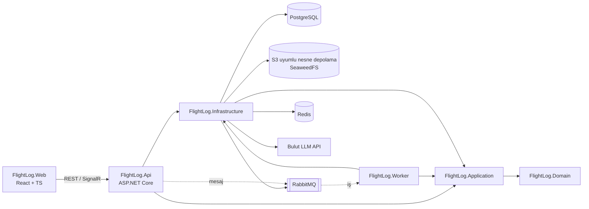
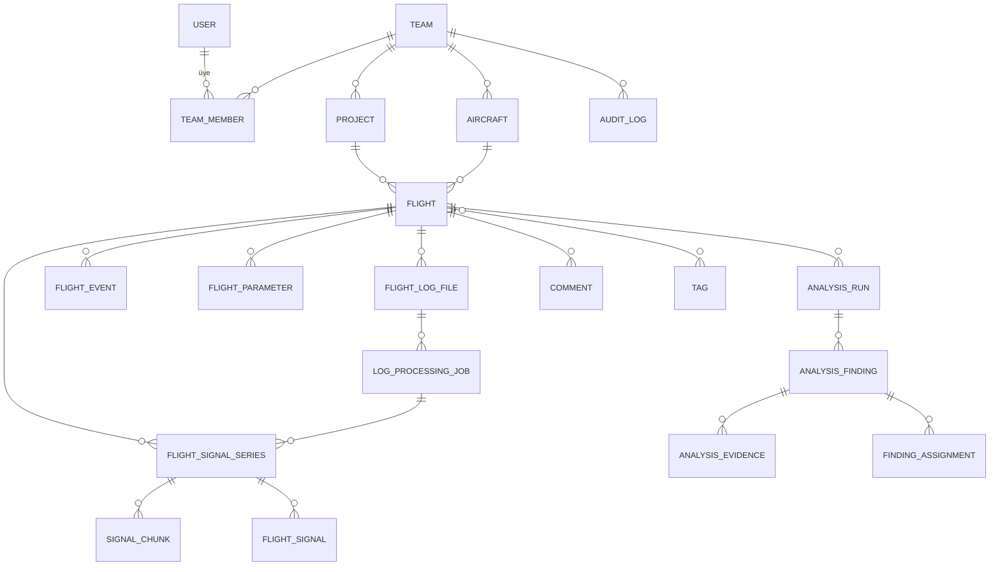
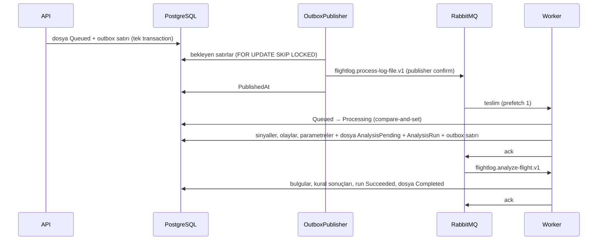
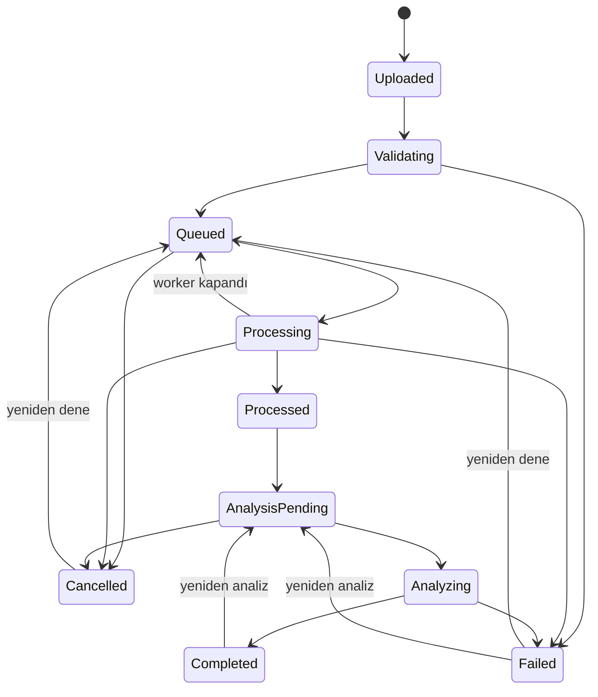

# Mimari

Bu doküman Aşama 0 değerlendirmesini, önerilen mimariyi, veri modelini ve API kaynaklarını içerir. Kararların gerekçeleri [docs/adr](adr/) altındadır.

## 1. Repository'nin başlangıç durumu

- Proje sıfırdan başlatıldı; mevcut kod yoktu. Kullanıcının GitHub hesabında bu ürüne ait bir repository bulunmadığı doğrulandı (`uav-ground-control-station` farklı bir ürün olduğu için kullanılmadı).
- Geliştirme ortamı: Ubuntu 24.04, .NET SDK 10.0.112 (Ubuntu arşivinden), Docker 29, Node 22, Python 3.12.
- Doğrulanan dış kaynaklar: nuget.org paketleri, Docker Hub imajları, pypi (pyulog 1.2.4 BSD-3, pymavlink 2.4.50 LGPL-3), PX4 pyulog örnek dosyaları (raw.githubusercontent.com).

## 2. Genel yapı

İlk sürüm **modüler monolit + ayrı worker** olarak tasarlanmıştır ([ADR-0001](adr/0001-modular-monolith.md)).



Bağımlılık yönü: `Api/Worker → Infrastructure → Application → Domain`. Domain hiçbir altyapı paketine bağımlı değildir; bu kural mimari testlerle (`FlightLog.UnitTests/Architecture`) doğrulanır.

### Katmanlar

| Proje | Sorumluluk | Bağımlılıklar |
|---|---|---|
| `FlightLog.Domain` | Entity'ler, değer nesneleri, durum makineleri, iş kuralları, domain hataları | Yok |
| `FlightLog.Application` | Use case servisleri, DTO'lar, doğrulayıcılar, yetki kontrolleri, altyapı arayüzleri (`IApplicationDbContext`, `ICurrentUser`, `IFileStorage`, `IFlightLogParser`, `IFlightAnalysisProvider`) | Domain, EF Core abstractions, FluentValidation |
| `FlightLog.Infrastructure` | EF Core `DbContext`, migration'lar, Identity, nesne depolama, RabbitMQ, Redis, parser adaptörleri, LLM adaptörü | Application |
| `FlightLog.Contracts` | Kuyruk mesajları ve worker/API arasında paylaşılan sözleşmeler (sürümlü) | Yok |
| `FlightLog.Api` | HTTP endpoint'leri, kimlik doğrulama, Problem Details, OpenAPI, sağlık kontrolleri | Application, Infrastructure |
| `FlightLog.Worker` | Log işleme, normalizasyon, kural analizi, AI analizi (Aşama 3+) | Application, Infrastructure, Contracts |
| `web/` | React + TypeScript arayüzü (ADR-0010); OpenAPI'den üretilen tiplerle API'yi çağırır, iş mantığı içermez | API (HTTP, SignalR) |

Application katmanı EF Core `DbSet`'lerine `IApplicationDbContext` üzerinden erişir; genel amaçlı repository/unit-of-work katmanı eklenmez ([ADR-0002](adr/0002-dotnet-postgres-efcore.md)). Kuyruk, depolama ve LLM gibi gerçekten değiştirilebilir dış bağımlılıklar arayüz arkasındadır.

## 3. Klasör yapısı

```
flightlog-intelligence/
├── src/
│   ├── FlightLog.Domain/
│   ├── FlightLog.Application/
│   ├── FlightLog.Infrastructure/
│   ├── FlightLog.Contracts/        (Aşama 2-4)
│   ├── FlightLog.Api/
│   ├── FlightLog.Worker/           (Aşama 3-4)
web/                              React arayüzü, nginx, Playwright testleri
├── tests/
│   ├── FlightLog.UnitTests/
│   ├── FlightLog.IntegrationTests/
│   └── FlightLog.ParserTests/      (Aşama 3)
├── docs/
│   ├── architecture.md, requirements.md, roadmap.md
│   └── adr/
├── docker-compose.yml
├── .env.example
└── .github/workflows/ci.yml
```

Henüz işlevi olmayan projeler boş iskelet olarak eklenmez; ilgili aşamada oluşturulur.

## 4. Veri modeli

### 4.1 Depolama ayrımı

| Veri | Yer | Neden |
|---|---|---|
| Kullanıcı, ekip, proje, araç, uçuş, dosya metadata'sı, iş durumu, bulgu, yorum, denetim | PostgreSQL | İlişkisel, sorgulanan, işlemsel veri |
| Ham log dosyası | Nesne depolama (`raw/{sha256}`) | Büyük, değişmez ikili veri |
| Sinyal örnekleri (ham alanlar ve normalize sinyaller) | Nesne depolama, seri (mesaj + instance) başına sıkıştırılmış blok dosyaları: `derived/{flightId}/{jobId}/{seri}/{blok}.fls` | Milyonlarca örnek; zaman aralığı ile okunur, satır bazlı sorgulanmaz |
| Sinyal kataloğu, blok indeksi, özet istatistikler | PostgreSQL | Hangi sinyal var, hangi zaman aralığı hangi blokta, min/max/ortalama |
| Olaylar, mod geçişleri, parametreler, işleme denemeleri | PostgreSQL | Sayıları küçük (yüzler-binler), filtrelenir ve birleştirilir |

Gerekçe ve alternatifler (tek büyük tablo, TimescaleDB, Parquet): [ADR-0005](adr/0005-time-series-storage.md). Nesne depolama sunucusu: [ADR-0009](adr/0009-object-storage-server.md).

Ham dosyalar içerik adreslidir: aynı içerik farklı ekiplerce yüklenirse tek nesne saklanır, ama her ekibin kendi `FlightLogFile` kaydı vardır. Nesne, ona başvuran son kayıt silindiğinde silinir.

### 4.2 ERD (hedef v1 şeması)

Aşama 1'de yalnızca kimlik, ekip, ekip üyeliği ve proje tabloları oluşturulur; diğerleri ilgili aşamada migration ile eklenir.



### 4.3 Veri sözlüğü (özet)

| Entity | Önemli alanlar | Kısıtlar / indeksler | Aşama |
|---|---|---|---|
| `User` (Identity) | Id (uuid), Email, DisplayName, CreatedAt | Email unique | 1 |
| `Team` | Id, Name, CreatedAt, CreatedBy | — | 1 |
| `TeamMember` | TeamId, UserId, Role (ProjectManager/Engineer/Viewer), JoinedAt | PK (TeamId, UserId); idx UserId | 1 |
| `Project` | Id, TeamId, Name, Description, CreatedAt, UpdatedAt, Version (xmin) | unique (TeamId, Name); idx TeamId | 1 |
| `Aircraft` | Id, TeamId, Name, Identifier, Type, Autopilot, FirmwareName/Version, FlightController, Hardware, Description, Tags | unique (TeamId, Identifier) | 2 |
| `Flight` | Id, ProjectId, AircraftId?, StartedAt?, DurationUs?, Autopilot, FirmwareVersion?, VehicleType?, Hardware?, BootTimeUtc?, LogStartTimestampUs?, LogMetadata (jsonb), OccurredAt | idx (ProjectId, OccurredAt), (AircraftId, OccurredAt) | 2-3 |
| `FlightLogFile` | Id, FlightId, TeamId, OriginalFileName, SizeBytes, Sha256, DetectedFormat, StorageKey, Status, UploadedBy, UploadedAt | unique (TeamId, Sha256); idx Status | 2 |
| `LogProcessingJob` | Id, LogFileId, FlightId, Attempt, Outcome (Running/Succeeded/Failed/Cancelled), WorkerId, CorrelationId, StoragePrefix, StartedAt, FinishedAt, DurationMs, AllocatedBytes, ParserName/Version, NormalizationVersion, kayıt/seri/sinyal/olay/parametre/blok sayıları, ChunkBytes, SkippedBytes, Truncated, Corrupt, Warnings (text[]), FailureCode, FailureMessage | idx (LogFileId, StartedAt) | 3 |
| `FlightSignalSeries` | Id, FlightId, JobId, Message, Instance, Kind (Raw/Normalized), RecordCount, FirstTimestampUs, LastTimestampUs, ColumnCount, StoragePrefix | idx FlightId | 3 |
| `SignalChunks` | SeriesId, Index, StartTimestampUs, EndTimestampUs, RecordCount, SizeBytes | PK (SeriesId, Index) | 3 |
| `FlightSignal` | Id, FlightId, SeriesId, Name, Kind, Message, Instance, Field, Column, SourceType, Unit, Multiplier, SourceMessage/Instance/Fields, Conversion, NormalizationVersion, SampleCount, InvalidCount, Min, Max, First/LastTimestampUs | unique (FlightId, Name) | 3 |
| `FlightEvent` | Id, FlightId, TimestampUs, Kind (Message/ModeChange/Armed/Disarmed/Failsafe/Error/Event/Dropout), Severity?, Source, Text, Data (jsonb) | idx (FlightId, TimestampUs) | 3 |
| `FlightParameter` | Id, FlightId, Name, Value, DefaultValue?, TimestampUs? (null = log başındaki değer) | idx (FlightId, Name) | 3 |
| `AnalysisRun` | Id, TeamId, FlightId, LogFileId, Kind (Rules), Trigger (Automatic/Manual), Status (Queued/Running/Succeeded/Failed/Cancelled), EngineVersion, RequestedBy?, Attempt, RetryCount, NextAttemptAt?, WorkerId, CorrelationId, CreatedAt, StartedAt, FinishedAt, DurationMs, bulgu ve kural sayıları, InputSummary (jsonb), FailureCode/Message, Version (xmin) | idx (FlightId, CreatedAt), (Status, CreatedAt), LogFileId | 4 |
| `AnalysisRuleResult` | RunId, RuleId, RuleVersion, Status (Applied/NotApplicable/Failed), Reason, FindingCount, Signals (text[]), DurationMs | PK (RunId, RuleId) | 4 |
| `AnalysisFinding` | Id, RunId, FlightId, RuleId, RuleVersion, Category, Title, Description, Severity (Info/Warning/Critical), Confidence (Low/Medium/High), StartUs, EndUs, Signals (text[]), Measured (jsonb), Threshold (jsonb), ThresholdSource, DataCoverage?, OccurrenceCount, Limitations? | idx (RunId, StartUs), FlightId | 4 |
| `AiAnalysis` | Id, TeamId, FlightId, AnalysisRunId (dayandığı kural analizi), RequestedBy, Status (Queued/Running/Succeeded/Failed), Provider, Model, ResponseModel, PromptVersion, ContextVersion, ContextHash, Context (text; byte olarak korunur), ContextSummary (jsonb), Attempt, RetryCount, NextAttemptAt?, WorkerId, ProviderCalls, LatencyMs, Input/Output/CacheRead/CacheWriteTokens, CostUsd?, StopReason, RawOutput, Report (jsonb, doğrulanmış), FailureCode/Message, Version (xmin) | idx (FlightId, CreatedAt), (Status, CreatedAt), (TeamId, CreatedAt), AnalysisRunId | 6 |
| `OutboxMessage` | Id, Type, AggregateId, Payload (jsonb), CorrelationId, CreatedAt, AvailableAt, PublishedAt?, PublishAttempts, LastError | kısmi idx (AvailableAt, Id) where PublishedAt is null; idx AggregateId, PublishedAt | 4 |
| `AnalysisEvidence`, inceleme durumu (`ReviewStatus`) | FindingId, SignalId?/EventId?, StartUs, EndUs, Value (jsonb) | — | 7 (ertelendi) |
| `Comment` | Id, FlightId, AuthorId, Body, StartUs?, EndUs?, CreatedAt, EditedAt | idx (FlightId, CreatedAt) | 7 |
| `FindingAssignment` | FindingId, AssigneeId, AssignedBy, AssignedAt | — | 7 |
| `Tag` / `FlightTag` | TeamId, Name / FlightId, TagId | unique (TeamId, Name) | 7 |
| `AuditLog` | Id, TeamId?, ActorId, Action, EntityType, EntityId, Changes (jsonb), OccurredAt | idx (TeamId, OccurredAt) | 7 |
| `AiProviderConfiguration` | Provider, Model, Enabled, MaxTokens, Limits (anahtar burada değil) | — | 6 |
| `FlightComparison`, `Report` | Hesaplanmış çıktı metadata'sı; içerik nesne depolamada | — | 7 |

Tüm zaman damgaları UTC `timestamptz`. Uçuş içi zamanlar `bigint` mikro saniye (orijinal boot zamanı) olarak saklanır.

## 5. Zaman modeli

| Format | Orijinal zaman | Mutlak zaman |
|---|---|---|
| PX4 ULog | Her mesajda `uint64 timestamp`: açılıştan itibaren µs (monoton saat). SITL logları bu saati Unix epoch'tan sayabilir. Hiç yayınlanmamış topic'ler `timestamp = 0` taşır. | GPS konumu (`vehicle_gps_position`, yoksa `sensor_gps`) `fix_type ≥ 3` ve `time_utc_usec > 0` olduğunda: açılış UTC'si = `time_utc_usec − timestamp`. |
| ArduPilot DataFlash | `TimeUS`, yoksa `TimeMS × 1000`, ikisi de yoksa bir önceki mesajın zamanı (pymavlink ile aynı). | `GPS` instance 0, `Status ≥ 3` ve `GWk > 0`: GPS zamanı = 1980-01-06 + `GWk` hafta + `GMS` ms; UTC = GPS zamanı − artık saniye (2017'den beri 18 s, önceki tarihler için IERS tablosu); açılış UTC'si = UTC − `TimeUS`. |

- **Orijinal zaman hiç değiştirilmez.** Sinyal blokları, olaylar ve parametre değişiklikleri logun kendi saatindeki µs değerini saklar; API de bu değeri döner (`timestampsUs`, `timestampUs`).
- **Uçuş başlangıcı**: ULog'da dosya başlığındaki zaman damgası (logger'ın başladığı an; pyulog `start_timestamp` ile aynı), DataFlash'ta ilk veri kaydının zamanı. `Flight.LogStartTimestampUs` olarak saklanır; süre = son zaman damgası − başlangıç.
- **UTC**: `Flight.BootTimeUtc` biliniyorsa `utc = BootTimeUtc + t µs` ve `StartedAt = BootTimeUtc + LogStartTimestampUs`. GPS zamanı yoksa ikisi de `null` kalır; tahmin yapılmaz. Listeleme tarihi (`OccurredAt`) o durumda yükleme zamanıdır.
- Açılış zamanları gerçek fixture'larda pyulog/pymavlink ile hesaplanan değerlerle birebir doğrulandı (`InterpreterTests`).

### 5.1 Sinyaller ve normalizasyon (v1)

Her sayısal log alanı bir **ham sinyal** olarak saklanır: ad `Mesaj.Alan`, instance 0 dışında `Mesaj#n.Alan` (`ATT.Roll`, `IMU#1.AccX`, `vehicle_attitude.q[0]`). Birim logun beyan ettiğidir (DataFlash `UNIT`/`FMTU`; ULog birim taşımaz). DataFlash'in beyan ettiği ama değere uygulanmamış çarpan (`MULT`) `Multiplier` olarak saklanır ve API okurken uygular (ör. `GPS.GMS`: ms → s). Metin alanları sinyal olmaz; mesajlar olay olarak saklanır.

**Normalize sinyaller** (`attitude.*`, `gps.*`, `battery.*`) biçimden bağımsız adlardır ve kaynaklarını saklar (`SourceMessage`, `SourceFields`, `Conversion`, `NormalizationVersion = 1`). Kurallar `src/FlightLog.LogParsing/Normalization/SignalNormalizer.cs` içindedir:

| Sinyal | Birim | PX4 | ArduPilot |
|---|---|---|---|
| `attitude.roll`, `.pitch`, `.yaw` | deg | `vehicle_attitude.q[0..3]` → Euler ZYX, rad → deg; yaw −180…180 | `ATT.Roll/Pitch/Yaw`; yaw 0…360 → −180…180 |
| `gps.lat`, `.lon` | deg | `latitude_deg/longitude_deg` (1.14+) veya `lat/lon` × 1e-7 | `GPS.Lat/Lng` |
| `gps.alt_msl` | m | `altitude_msl_m` veya `alt` × 1e-3 | `GPS.Alt` |
| `gps.fix_type`, `.satellites`, `.hdop`, `.ground_speed` | —, —, —, m/s | `fix_type`, `satellites_used`, `hdop`, `vel_m_s` | `Status`, `NSats`, `HDop`, `Spd` |
| `battery.voltage`, `.current`, `.remaining` | V, A, % | `battery_status.voltage_v`, `current_a` (−1 → geçersiz), `remaining` × 100 (negatif → geçersiz) | `BAT.Volt`, `Curr`, `RemPct` (255 → geçersiz) |

Kurallar yalnızca instance 0 kaynağını kullanır. Kaynak alanlardan biri yoksa sinyal hiç üretilmez (sıfır yazılmaz). Geçersiz/ölçülmemiş değerler `NaN` olarak saklanır, API'de `null` döner ve katalogda `InvalidCount` ile sayılır. Titreşim ve barometrik irtifa v1'de normalize edilmedi: PX4 ve ArduPilot'ta anlamları farklı (tek titreşim metriği / eksen başına; AMSL / açılışa göre), ham sinyal olarak kullanılabilirler.

## 6. Parser doğrulama planı

Ayrıntı: [ADR-0004](adr/0004-native-csharp-parsers.md).

1. **Resmi spesifikasyon**: PX4 ULog File Format (docs.px4.io) ve ArduPilot DataFlash FMT/FMTU tanımları.
2. **Native C# parser**: `FlightLog.LogParsing` projesi (yalnızca .NET temel kütüphanesi), arabellekli seekable okuyucu ile format başına bir `IFlightLogParser` (`ULogParser`, `DataFlashParser`); kayıtlar bir `ILogRecordSink`'e akıtılır, dosya belleğe alınmaz.
3. **Oracle testleri**: Aynı fixture dosyaları pyulog (BSD-3) ve pymavlink (LGPL-3) ile okunup beklenen değerler JSON olarak üretilir; C# parser çıktısı bu JSON'larla karşılaştırılır. Python yalnızca test verisi üretiminde kullanılır, çalışma zamanında kullanılmaz.
4. **Fixture'lar**: pyulog repository'sindeki örnek `.ulg` dosyaları (BSD-3), ArduPilot SITL'den üretilen veya lisansı uygun `.bin` dosyaları; ayrıca bozuk/kesik/bilinmeyen mesaj içeren küçük üretilmiş dosyalar.
5. **Sınırlar**: parser zaman aşımı, maksimum mesaj boyutu, maksimum format sayısı; aşıldığında kontrollü hata.

## 7. API kaynakları

Sürümleme: URL segmenti (`/api/v1/...`). Kırıcı değişiklikte `v2` eklenir; v1 belgelenmiş bir süre korunur.

| Kaynak | Endpoint'ler | Aşama |
|---|---|---|
| Auth | `POST /api/v1/auth/register`, `POST /api/v1/auth/login`, `POST /api/v1/auth/refresh`, `GET /api/v1/auth/me` | 1 |
| Admin users | `GET/POST /api/v1/admin/users`, `POST /api/v1/admin/users/{id}/disable`, `POST /api/v1/admin/users/{id}/enable` (yalnızca Administrator) | 2 |
| Teams | `GET/POST /api/v1/teams`, `GET /api/v1/teams/{id}` | 1 |
| Team members | `GET/POST /api/v1/teams/{id}/members`, `PUT/DELETE /api/v1/teams/{id}/members/{userId}` | 1 |
| Projects | `GET/POST /api/v1/teams/{teamId}/projects`, `GET/PUT/DELETE /api/v1/projects/{id}` | 1 |
| Aircraft | `GET/POST /api/v1/teams/{teamId}/aircraft`, `GET/PUT/DELETE /api/v1/aircraft/{id}` | 2 |
| Flights | `GET /api/v1/flights?teamId&projectId&aircraftId&autopilot&status&firmware&from&to&search&sort&page&pageSize`, `GET/PUT/DELETE /api/v1/flights/{id}` | 2 |
| Uploads | `POST /api/v1/projects/{id}/logs?aircraftId&name` (multipart, alan `file`; yeni uçuş oluşturur), `GET /api/v1/log-files/{id}`, `GET /api/v1/log-files/{id}/content` | 2 |
| Processing state | `POST /api/v1/log-files/{id}/cancel`, `POST /api/v1/log-files/{id}/retry` | 2 |
| Processing jobs | `GET /api/v1/log-files/{id}/jobs` (deneme geçmişi, süre, bellek, parser istatistikleri) | 3 |
| Signals | `GET /api/v1/flights/{id}/signals?kind&search`, `GET /api/v1/flights/{id}/signals/data?names&fromUs&toUs&maxPoints` | 3 |
| Events | `GET /api/v1/flights/{id}/events?kind&maxSeverity&fromUs&toUs&search&page&pageSize` | 3 |
| Parameters | `GET /api/v1/flights/{id}/parameters?search&changedOnly` | 3 |
| Analysis | `POST/GET /api/v1/flights/{id}/analysis-runs`, `GET /api/v1/analysis-runs/{id}`, `GET /api/v1/analysis-runs/{id}/findings?minSeverity&category&ruleId&page&pageSize`, `GET /api/v1/analysis-rules` | 4 |
| AI analysis | `POST/GET /api/v1/flights/{id}/ai-analyses`, `GET /api/v1/ai-analyses/{id}`, `/context`, `/report.md`, `GET /api/v1/teams/{teamId}/ai-status`, `GET /api/v1/admin/ai/usage?days` | 6 |
| Processing stats | `GET /api/v1/admin/processing/stats?hours` (yalnızca Administrator) | 4 |
| Dashboard | `GET /api/v1/teams/{teamId}/dashboard` | 5 |
| Realtime | SignalR `/hubs/processing` (`StatusChanged`; ekip grupları, yöneticiler için ayrı grup) | 5 |
| Findings | `PATCH /api/v1/findings/{id}` (durum), `POST /api/v1/findings/{id}/assignments` | 7 |
| Comparisons | `POST /api/v1/flights/compare` | 7 |
| Comments, Tags | `GET/POST /api/v1/flights/{id}/comments`, `PUT /api/v1/flights/{id}/tags` | 7 |
| Reports | `GET /api/v1/flights/{id}/report?format=json|csv` | 7 |

Kurallar: DTO ile entity ayrımı, FluentValidation, Problem Details (RFC 9457), `CancellationToken`, sayfalama (`page`, `pageSize` ≤ 100), başka ekibin kaynağı için 404.

## 8. Asenkron işleme

Ayrıntı: [ADR-0006](adr/0006-messaging-and-background-jobs.md).

- İş durumu PostgreSQL'de tutulur (gerçeğin kaynağı); RabbitMQ yalnızca "şu iş hazır" sinyalini taşır.
- Mesaj yayını transactional outbox ile yapılır: dosya kaydı ve outbox satırı aynı transaction'da yazılır.
- Worker işi alırken `UPDATE ... WHERE status = 'Queued'` ile iyimser kilit alır; aynı mesaj iki kez gelirse ikinci işlem hiçbir şey yapmaz (idempotent).
- Türetilmiş veri yazımı "uçuşa ait önceki çıktıları sil + yenilerini yaz" tek transaction'da yapılır; tekrar işlemede yinelenme olmaz.
- Retry: geçici hatalarda en fazla 3 otomatik deneme (30 s × 2^(n−1), en fazla 10 dk); tükenince dead-letter queue ve `Failed` (`processing.retries_exhausted`).
- Periyodik bakım (takılı işlerin kurtarılması, kaybolan mesajların yeniden duyurulması, outbox temizliği) worker içindeki `MaintenanceWorker` ile yapılır; Hangfire kullanılmadı (ADR-0006 uygulama notları).

**Aşama 4 uygulaması:**



1. Worker işi alırken dosyanın satır sürümünü (`xmin`) koşul olarak kullanır (compare-and-set); birden çok worker aynı dosyayı alamaz, tekrar gelen mesaj hiçbir şey yapmaz.
2. Ham dosya geçici dizine indirilir; parser, yorumlayıcı, normalizasyon ve blok yazıcı tek geçişte çalışır (`Processing:ParserTimeout`, 15 dk).
3. Bloklar `derived/{flightId}/{jobId}/…` altına yüklenir; tek transaction'da uçuşun eski sinyal/olay/parametre satırları silinip yenileri yazılır, dosya `AnalysisPending` olur ve otomatik bir `AnalysisRun` kuyruğa alınır.
4. Analiz işi run'ı `Queued → Running`, dosyayı `Analyzing` yapar; kurallar çalışır; bulgular, kural sonuçları, run `Succeeded` ve dosya `Completed` tek transaction'da yazılır. Daha yeni bir run varsa ya da dosya artık analiz beklemiyorsa run `analysis.superseded` ile biter.
5. Hata: parser'ın kararlı kodu (`ulog.invalid_header`, `processing.no_data`, `parser.timeout`…) dosyaya ve işe yazılır, yeniden denenmez. Geçici altyapı hatası `processing.transient_failure` (analizde `analysis.transient_failure`) ile kaydedilir ve otomatik denenir. Beklenmeyen hatada kullanıcıya yalnızca kod ve korelasyon kimliği gösterilir. Analiz başarısız olursa dosya `Failed` olur ama işlenmiş veri (sinyaller, olaylar) okunabilir kalır; analiz yeniden istenebilir.
6. Kullanıcı işlem sırasında iptal ederse (her 5 s'de kontrol) iş `Cancelled` biter, yazılan bloklar silinir. Worker düzgün kapanırken dosya `Queued` durumuna döner. 30 dakikadan uzun `Processing` (analizde 10 dakikadan uzun `Running`) kalan iş çöken worker sayılır ve yeniden denenir; denemeler tükenmişse `processing.interrupted` ile `Failed` olur.

API geliştirme ortamında aynı döngüyü kendi içinde çalıştırabilir (`Processing:Enabled = true`, `appsettings.Development.json`); Docker Compose'da işleme yalnızca `worker` servisindedir.

### İşleme durum makinesi



Geçiş tablosu `ProcessingStatusTransitions` içindedir (`src/FlightLog.Domain/Flights/ProcessingStatus.cs`); tüm durum çiftleri unit testle doğrulanır. `Failed` yalnızca hata kodu ve mesajıyla (`Fail`) girilebilir. Yükleme `Uploaded → Validating → Queued` adımlarını aynı istekte tamamlar. `Queued → Processing → Processed → AnalysisPending` işleme işinde, `AnalysisPending → Analyzing → Completed` analiz işinde yürütülür (`Processed` aynı transaction içinde geçilir). Analiz başarısız olan dosya (`Failed`, kod `analysis.*`) yeniden analiz için doğrudan `AnalysisPending` olabilir.

### 8.1 Kural tabanlı teknik analiz

Kod: `src/FlightLog.Application/Analysis`. Motor sürümü `rules-1`; her kuralın kendi kimliği ve sürümü vardır ve bulguya yazılır.

- **Girdi:** işleme işinin ürettiği sinyaller (nesne depolamadaki bloklardan, yalnızca kuralın istediği sütunlar), olaylar ve parametreler. Analiz ham dosyayı yeniden okumaz.
- **Analiz pencereleri:** kurallar aracın arm'lı olduğu aralıklara bakar. Log `Disarmed` ile başlıyorsa araç log başından beri arm'lı kabul edilir. Logda arm bilgisi yoksa bütün log analiz edilir, güven bir kademe düşer ve bulguya bu sınırlama yazılır.
- **Kural sonucu:** `Applied`, `NotApplicable` (gerekçesiyle, ör. "parametre yok") veya `Failed`. Bir kuralın hata vermesi diğerlerini durdurmaz; geçici altyapı hatası ise bütün run'ı yeniden denemeye gönderir. Kural başına en fazla 200 bulgu yazılır.
- **Bulgu:** başlık, açıklama, kategori, önem (Info/Warning/Critical), güven (Low/Medium/High), log saatiyle zaman aralığı (µs), kullanılan sinyaller, ölçülen değerler, uygulanan eşikler ve **eşiğin kaynağı** (araç parametresi, belgelenmiş değer veya kuralın sezgisel değeri), veri kapsamı, tekrar sayısı ve sınırlamalar.
- **Eşikler:** araçta karşılığı olan eşik varsa o kullanılır (ör. `BATT_LOW_VOLT`, `BAT_LOW_THR`, `AHRS_GPS_MINSATS`, `EKF2_REQ_NSATS`). Yoksa belgelenmiş değer (ArduPilot titreşim sınırları), o da yoksa sezgisel değer kullanılır ve bu açıkça yazılır. Gerekli parametre yoksa kural uygulanmaz; eşik uydurulmaz.

| Kural | Ne bulur | Önem |
|---|---|---|
| `gps.fix_loss` | 3D fix'e ulaştıktan sonra ≥ 1 s 3D fix kaybı | Warning; ≥ 10 s Critical |
| `gps.quality` | ≥ 5 s az uydu veya yüksek HDOP (araç parametresi, yoksa 6 uydu / HDOP 2.0) | Warning |
| `ekf.innovation` | ≥ 1 s innovation test oranı > 1 (ölçüm reddedildi); tüm EKF örnekleri birleştirilir | Warning |
| `ekf.messages` | Otopilotun EKF mesajları, ArduPilot EKFCHECK/EKF failsafe hataları, lane değişimi, EKF reset olayları | Otopilotun verdiği önem |
| `vibration.level` | ArduPilot VIBE > 30 m/s² (> 60 Critical), belgelenmiş sınırlar | Warning/Critical |
| `vibration.clipping` | İvmeölçer clipping sayacının artması (PX4 ve ArduPilot) | Warning |
| `battery.voltage` | Araçta ayarlı voltaj sınırının altında kalma (ArduPilot `BATT_LOW_VOLT`/`BATT_CRT_VOLT`/`BATT_LOW_TIMER`, PX4 `BAT_V_EMPTY` × hücre) | Warning/Critical |
| `battery.remaining` | Kalan kapasitenin ayarlı seviyelerin altına inmesi (PX4 `BAT_LOW_THR`/`BAT_CRIT_THR`, ArduPilot `BATT_LOW_MAH`/`BATT_CRT_MAH`) | Warning/Critical |
| `events.failsafe` | Failsafe tetiklenme ve temizlenme aralıkları | Critical |
| `events.errors` | Alt sistem hataları ve error ya da daha ağır önemdeki log mesajları | Warning/Critical |
| `modes.transitions` | Arm'lıyken dönüş/iniş modlarına geçiş; 10 s içinde ≥ 4 mod değişikliği | Info/Warning |
| `parameters.changes` | Uçuşta değiştirilen parametreler (ArduPilot `STAT_*` sayaçları hariç) | Info |
| `data.gaps` | Çekirdek sinyallerde olağan aralığın 10 katından (≥ 0,5 s) uzun boşluklar ve logger dropout'ları | Info; ≥ 2 s Warning |

Kuralların tam açıklaması, gereken veriler ve uygulanamadığı durumlar `GET /api/v1/analysis-rules` ile okunur. Aynı girdi aynı bulguları üretir (entegrasyon testiyle doğrulandı).

### 8.2 AI raporu (ADR-0008)

Kod: `src/FlightLog.Application/Ai`, adaptör `src/FlightLog.Infrastructure/Ai`. Kural analizinin üzerine kurulur, onu değiştirmez.

1. **İstek** (Engineer): özellik açık mı, aynı uçuşta bekleyen istek var mı, son kural analizi başarılı mı ve ekibin günlük kotası dolmuş mu kontrol edilir. `AiAnalysis` satırı ve outbox mesajı (`flightlog.ai-analyze-flight.v1`) aynı transaction'da yazılır.
2. **Bağlam** (worker): `FlightContextLoader` bulguları, kural sonuçlarını, olayları, parametreleri ve anahtar sinyallerin (batarya, GPS kalitesi, tutum; enlem/boylam hariç) tüm uçuş ve bulgu pencerelerindeki istatistiklerini okur. `FlightContextBuilder` bunları referanslı (`F`, `R`, `S`, `E`, `P`), deterministik bir JSON'a çevirir, sınırı aşarsa kırpar ve hash'ler.
3. **Çağrı:** `flight-report-v1` sistem talimatı, `<flight_context>` içinde bağlam ve JSON şemasıyla yapılandırılmış çıktı. Her çağrı (başarısız olanlar dahil) token, gecikme ve maliyetle hemen kaydedilir.
4. **Doğrulama:** `FlightReportValidator` şemayı, referansları ve sayıları kontrol eder. Geçersiz yanıt için tek onarım çağrısı yapılır. Sonuç `Report` (jsonb) olarak saklanır; Markdown çıktısı istekte üretilir.
5. **Hatalar:** reddetme, kesilme, bağlam penceresi, kimlik doğrulama ve istek reddi yeniden denenmez. 429/5xx/ağ hataları `Ai:MaxAutomaticRetries` kadar yeniden kuyruğa alınır. Takılı çalıştırmalar ve kaybolan mesajlar bakımda kurtarılır.

### 8.3 Canlı durum güncellemeleri (ADR-0011)

Dosya veya analiz durumu değiştiğinde, değişikliği yazan EF transaction'ı commit edildikten sonra `pg_notify('flightlog_status', ...)` gönderilir (`StatusNotificationInterceptor`). Bildirim worker'dan da gelse API'ye ulaşır: API'deki `StatusNotificationListener` PostgreSQL'i `LISTEN` ile dinler ve bildirimi SignalR hub'ında yalnızca ilgili ekibin grubuna (ve yöneticilere) iletir. Bildirim yalnızca neyin değiştiğini söyler (tür: dosya, analiz veya AI raporu; kimlik, durum, hata kodu); arayüz ayrıntıyı API'den yeniden okur. Bağlantı koparsa arayüz etkin işleri 15 saniyede bir yoklar, yeniden bağlanınca listeleri yeniler. Ayrı bir broker veya Redis backplane gerekmez; birden çok API örneği aynı kanalı dinler.

## 9. Güvenlik özeti

- ASP.NET Core Identity, bearer token + refresh token; parola politikası; giriş endpoint'lerinde rate limiting ve hesap kilitleme.
- Yetkilendirme backend'de, Application katmanında kaynak bazlı: her sorgu kullanıcının ekip üyeliğine göre filtrelenir.
- Ham log güvenilmeyen girdi: içerik doğrulama, boyut sınırı, parser zaman/bellek sınırı, depolama anahtarı sunucuda üretilir.
- Gizli bilgiler environment variable / secret store; `.env` dosyası git dışında.
- LLM'e giden veri minimize edilir (ham log, konum, uçuş adı/notu ve kullanıcı bilgisi gönderilmez); log içindeki metinler ayrı, "güvenilmeyen" bölümde gönderilir ve talimat olarak yorumlanmaz. API anahtarı yalnızca worker'dadır. Modelin yanıtı kanıt referansları ve sayılar açısından sunucuda doğrulanır; arayüzde "model yorumu" olarak, kural bulgularından ayrı gösterilir.
- Arayüz: access token yalnızca bellekte, refresh token `localStorage`'da (ADR-0010). nginx CSP ile satır içi script'i yasaklar, yalnızca aynı origin'e bağlantıya ve yapılandırılan harita karo sunucusuna izin verir. SignalR WebSocket'i token'ı sorgu dizesinde taşıdığı için nginx sorgu dizesini loglamaz. Log içindeki metinler (mesajlar, parametre adları) arayüzde düz metin olarak gösterilir, HTML olarak işlenmez.

## 10. Gözlemlenebilirlik

- Serilog: JSON çıktısı, istek logları, korelasyon kimliği (`X-Correlation-Id`).
- Metrikler (Aşama 4): `System.Diagnostics.Metrics` ile `FlightLog.Processing` meter'ı: işleme ve analiz sayıları (sonuca göre), süre, bellek, kuyruk bekleme süresi, otomatik denemeler, outbox yayınları. Dışa aktarma (OpenTelemetry exporter) Aşama 8'de; şimdilik `dotnet-counters` ile okunabilir. Yöneticiler için `GET /api/v1/admin/processing/stats` veritabanından özet verir: durum dağılımı, hata oranı ve kodları, süre ve kuyruk bekleme yüzdelikleri, bekleyen outbox ve kuyruk derinlikleri.
- OpenTelemetry (Aşama 8): ASP.NET Core, HttpClient, EF Core, RabbitMQ izleri ve metriklerin dışa aktarımı.
- Sağlık: `/health/live` (süreç) ve `/health/ready` (PostgreSQL, nesne depolama ve RabbitMQ taşıması seçiliyse RabbitMQ).
